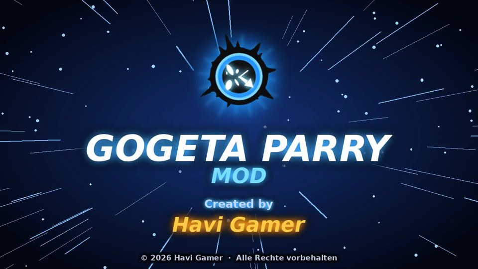
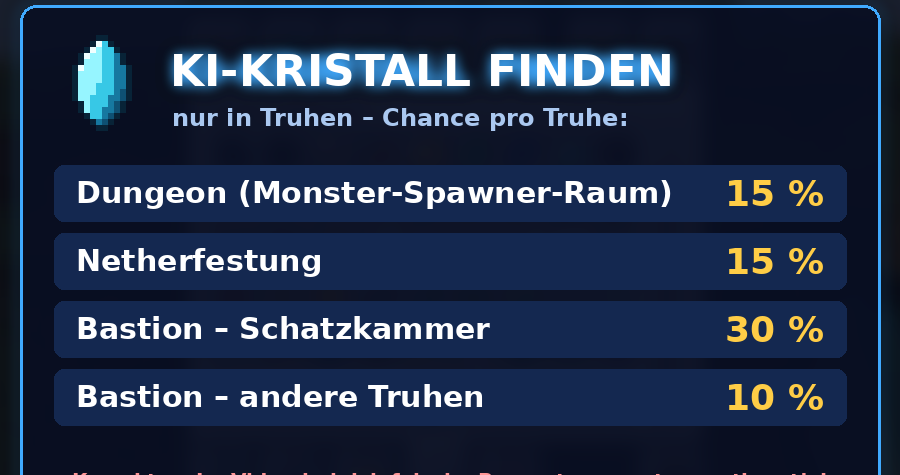
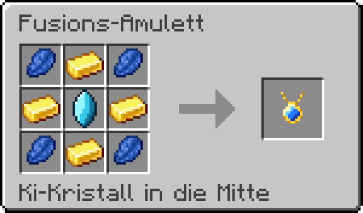
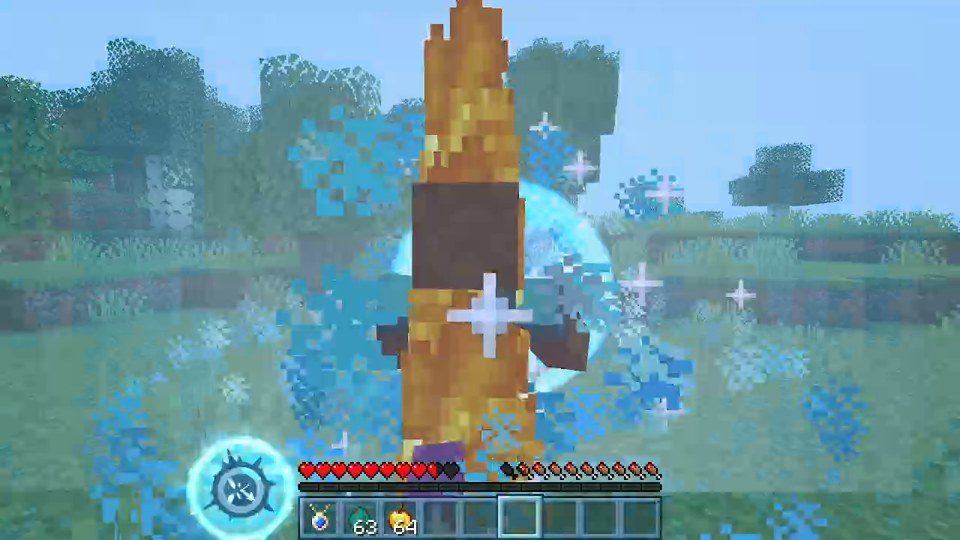
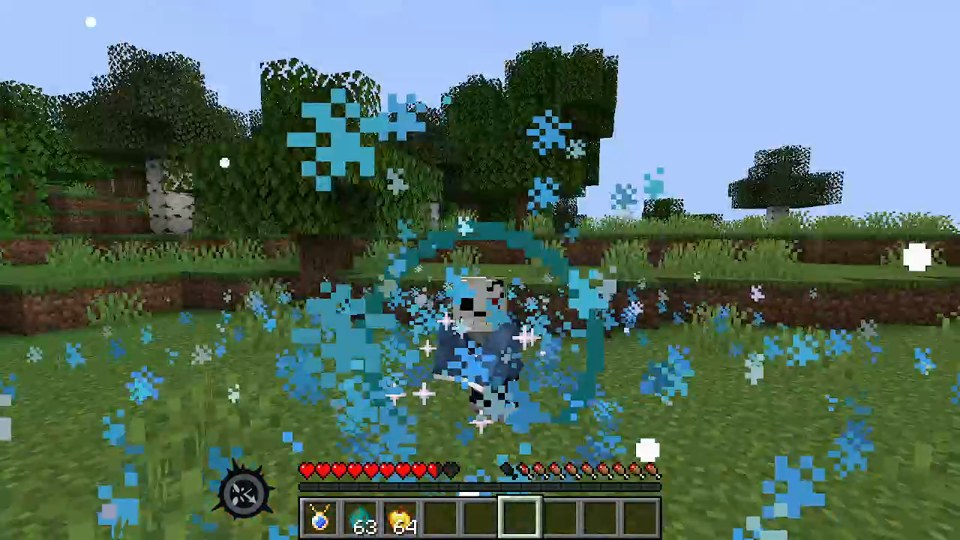

# Gogeta Parry Mod – Minecraft 1.20.1 (Forge)

**Meine erste Minecraft-Mod!** Inspiriert vom Gogeta-Parry aus *Dragon Ball Legends*:
Werde 5x getroffen, dein Counter-Kreis lädt sich auf – und der nächste Angriff wird **automatisch geparryt**.
Danach konterst du mit einem **fliegenden Kick** (Nahkampf) oder einem **Ki-Blast** (Fernkampf)!

## ⬇ Download

### 👉 [**Hier klicken: neueste Version herunterladen**](../../releases/latest) 👈

Auf der Seite unten bei **Assets** die Datei **`gogetaparry-1.20.1-….jar`** anklicken.
(Nicht „Source code“ – das ist nur der Quellcode.)

## 🛠 Installieren – so geht's

1. **Minecraft Forge 1.20.1 installieren**
   - Mit **CurseForge**: *Create Custom Profile* → Minecraft **1.20.1** → Modloader **Forge** → *Create*.
   - Ohne CurseForge: Installer von [files.minecraftforge.net](https://files.minecraftforge.net/net/minecraftforge/forge/index_1.20.1.html) laden und „Install client“ wählen.
2. **Die `.jar` in den `mods`-Ordner legen**
   - CurseForge: Profil öffnen → **⋯** → *Open Folder* → Ordner **`mods`**.
   - Normaler Launcher: `.minecraft/mods` (Windows: `Win + R` → `%appdata%\.minecraft\mods`).
3. **Empfohlen: [Curios API](https://www.curseforge.com/minecraft/mc-mods/curios) (Forge 1.20.1)** dazu installieren –
   dann kommt das Amulett in einen eigenen **Halsketten-Slot** und deine Rüstung bleibt frei.
4. **Minecraft mit dem Forge-1.20.1-Profil starten** – fertig! 🎉

> ⚠ Wichtig: Die **.jar**-Datei gehört in `mods`, nicht eine .zip-Datei.

## 💎 So bekommst du das Fusions-Amulett

**1. Ki-Kristall finden** – er liegt nur in **Truhen**:

**2. Amulett craften** – Ki-Kristall in die Mitte, Gold oben/unten/links/rechts, Lapis in die Ecken:

**3. Anlegen** – mit Curios in den Halsketten-Slot (Inventar → kleiner Knopf links), ohne Curios einfach ins Inventar.

## ⚡ So funktioniert's

| | |
|---|---|
| 🔵 **Kreis aufladen** | Jeder Treffer von einem Mob lädt den Kreis. Fallschaden & Explosionen zählen halb. Nach **5 Treffern** ist er voll. |
| 💚 **Kreis voll** | Du bekommst **5 Herzen** zurück. |
| 🛡 **Auto-Parry** | Der nächste Angriff macht **0 Schaden** – blaue Ki-Welle aus deiner Hand! |
| 🦶 **Konter** | Nahkampf → **fliegender Kick**, Fernkampf (Pfeile, Feuerbälle) → **Ki-Blast**. **40 Schaden** + 10 % Heilung. |
| ⚔ **Power-Up** | **10 Sekunden**: **+30 % Schaden** und **+10 % Tempo**. |
| ⏳ **Abklingzeit** | Danach **20 Sekunden** Pause. |

Taste **H** verschiebt den Counter-Kreis (Hotbar → oben rechts → Fadenkreuz).
Alle Werte kannst du in `config/gogetaparry-common.toml` ändern.

## 🎬 Video

Das Video zur Mod gibt's auf meinem YouTube-Kanal **Havi Gamer**.

---

© 2026 **Havi Gamer** – alle Rechte vorbehalten (siehe [LICENSE](LICENSE)).
Bitte nicht woanders hochladen – verlinkt einfach diese Seite. 🙏

*Fan-Mod, inspiriert von Dragon Ball Legends. Nicht offiziell und nicht mit Bandai Namco, Toei Animation oder Mojang verbunden.*

Für Entwickler: [Mod selbst bauen & Code-Übersicht](docs/ENTWICKLER.md)
